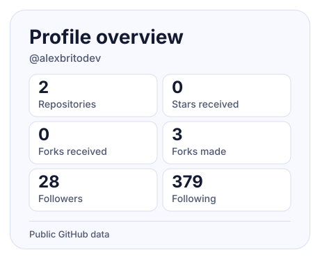
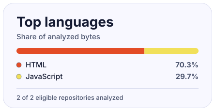
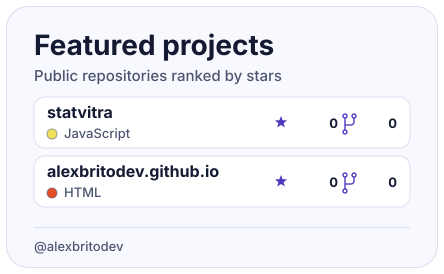
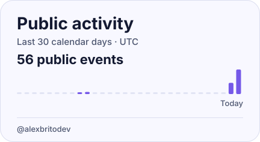

# 👋 I'm Alex Brito.

Brazilian developer with over 15 years of experience. To me, software development is an exercise in logic and longevity, not just syntax.

I founded [INformigados](https://github.com/informigados/) to counter the "move fast and break things" culture. We prioritize clean architecture and stability because digital infrastructure should be efficient and built to endure — not just shipped.

## 🧠 The Intersection of Code & Thought

Beyond engineering, I am a Professor of Technology and Philosophy.

This isn't just a side role; it defines how I work. Teaching philosophy keeps my reasoning rigorous, while teaching technology keeps my skills sharp. I apply critical thinking to system design, ensuring complexity is managed — not merely hidden.

## 🚀 Core Competencies

- Architecture & Dev: HTML, PHP, JavaScript (React), CSS (Tailwind), WordPress.

- System Logic: Performance optimization, complex integrations, and technical consulting.

- Methodology: Transforming abstract requirements into solid, scalable logic.

## 📊 GitHub Stats

<!-- statvitra:start -->

<picture>
  <source media="(prefers-reduced-motion: no-preference) and (prefers-color-scheme: dark)" srcset="./statvitra-cards/overview-dark-motion.svg">
  <source media="(prefers-reduced-motion: no-preference) and (prefers-color-scheme: light)" srcset="./statvitra-cards/overview-light-motion.svg">
  <source media="(prefers-color-scheme: dark)" srcset="./statvitra-cards/overview-dark.svg">
  
</picture>
<picture>
  <source media="(prefers-reduced-motion: no-preference) and (prefers-color-scheme: dark)" srcset="./statvitra-cards/languages-dark-motion.svg">
  <source media="(prefers-reduced-motion: no-preference) and (prefers-color-scheme: light)" srcset="./statvitra-cards/languages-light-motion.svg">
  <source media="(prefers-color-scheme: dark)" srcset="./statvitra-cards/languages-dark.svg">
  
</picture>
 
<picture>
  <source media="(prefers-reduced-motion: no-preference) and (prefers-color-scheme: dark)" srcset="./statvitra-cards/projects-dark-motion.svg">
  <source media="(prefers-reduced-motion: no-preference) and (prefers-color-scheme: light)" srcset="./statvitra-cards/projects-light-motion.svg">
  <source media="(prefers-color-scheme: dark)" srcset="./statvitra-cards/projects-dark.svg">
  
</picture>
<picture>
  <source media="(prefers-color-scheme: dark)" srcset="./statvitra-cards/activity-dark.svg">
  
</picture>

[Read the stats as text](./statvitra-cards/REPORT.md)

<!-- statvitra:end -->

## 🛠️ Toolbelt

## 🌎 Context

Based in Brazil. 🇧🇷

I am open to collaborations that value substance over hype.

If you’re building something meaningful, let’s talk.
